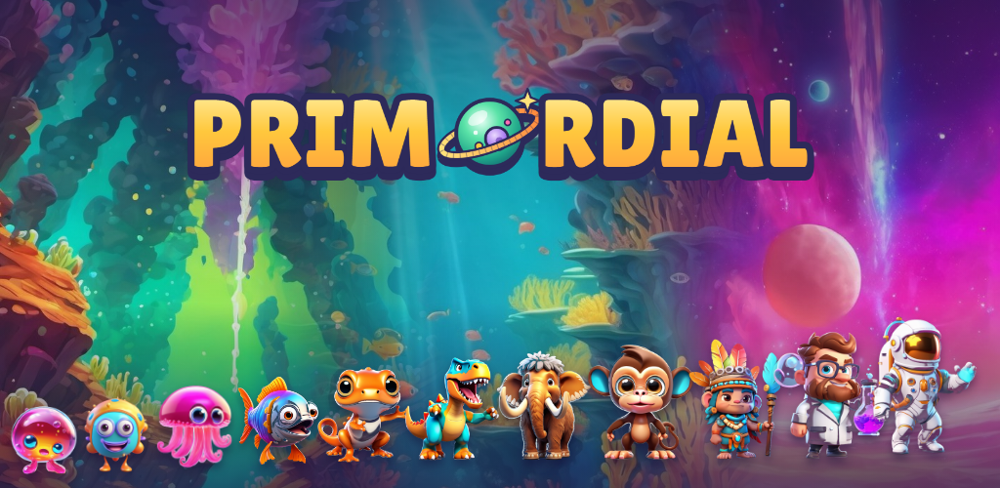
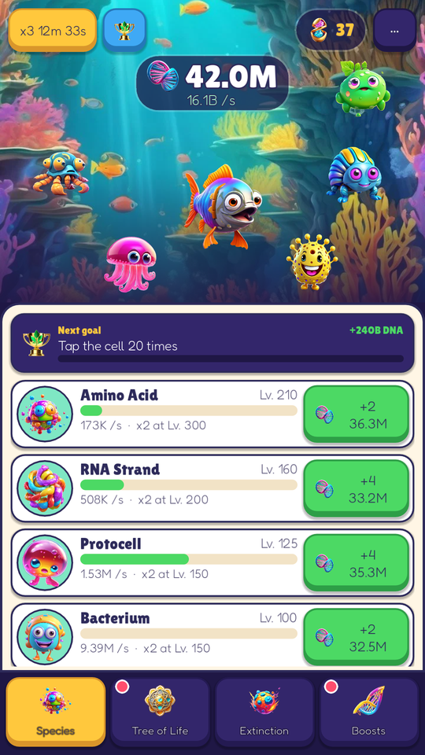
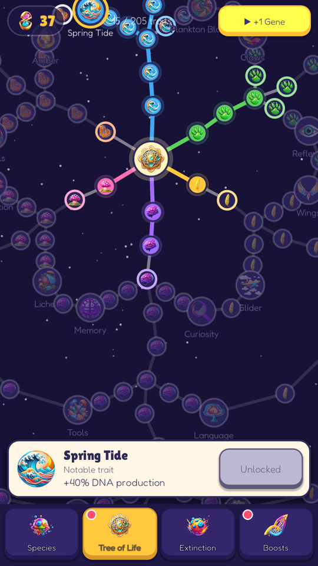
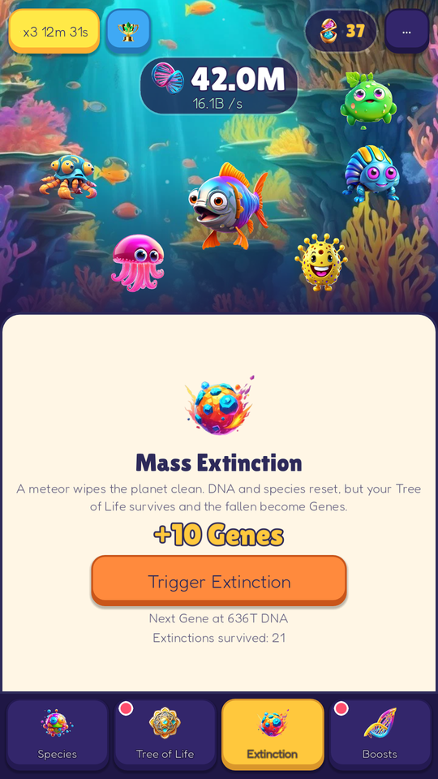
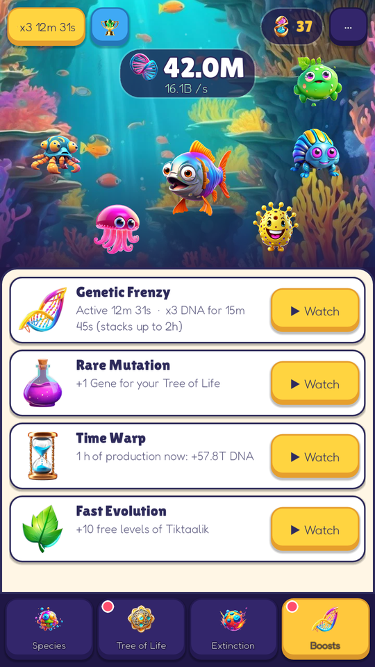

  

  <b>Tap a single cell into life and evolve it all the way to the stars.</b> 
  An idle evolution game for Android by BananaWare.

  <a href="https://github.com/LuisPCFialho/primordial-apk/releases/latest/download/Primordial.apk"><b>⬇ Download the latest APK</b></a> ·
  <a href="https://github.com/LuisPCFialho/primordial-apk/releases">All versions</a> ·
  <a href="https://primordial-idle.vercel.app">Website</a> ·
  <a href="https://primordial-idle.vercel.app/privacy.html">Privacy policy</a>

  
  
  
  

## The game

- **40 species** across **8 eras**, from amino acids in the primordial soup to astronauts.
- **Tree of Life** with 205 traits in six branches.
- **Mass Extinctions** that reset the run but make the next one stronger.
- **Happy creatures:** tap a creature 12 times in a row for a DNA bonus.
- **Daily gifts, daily missions, achievements** and a **Next goal** guide for the first hour.
- **World rankings** with Google Play Games (taps, levels bought, extinctions).
- Plays in **English, Português (Portugal and Brasil), Español, Français and Deutsch**.

This repository only holds the test builds (APK). The source code is private.

## Install

1. On your phone, open **[Primordial.apk (latest)](https://github.com/LuisPCFialho/primordial-apk/releases/latest/download/Primordial.apk)**.
2. Allow your browser to "install unknown apps" when Android asks.
3. Open the downloaded file and tap **Install**.

Requires Android 7.0 or newer.

## Update

Download from the same link again and install over the old version: your progress is kept.
Every version and its notes are in [Releases](https://github.com/LuisPCFialho/primordial-apk/releases).

If you already have the game from Google Play (closed test), Android will not install the APK over it
because the signatures are different. Use one or the other, or uninstall first (you lose your progress).

The APK uses Google's **test ads**; the Google Play version shows real ads.

---

## Português

**Primordial** é um jogo idle de evolução para Android: toca numa célula, faz evoluir a vida por 8 eras
e 40 espécies, desbloqueia a Árvore da Vida e provoca Extinções em Massa para ficares mais forte.

**Instalar:** no telemóvel abre o [APK mais recente](https://github.com/LuisPCFialho/primordial-apk/releases/latest/download/Primordial.apk),
autoriza o browser a instalar apps desconhecidas e carrega em Instalar. **Atualizar:** descarrega pelo
mesmo link e instala por cima; o progresso mantém-se. Se tens o jogo da Google Play, não dá para
instalar o APK por cima (assinaturas diferentes).
