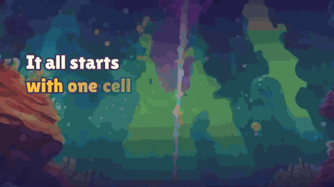
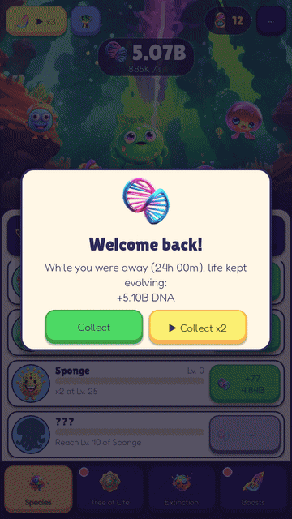
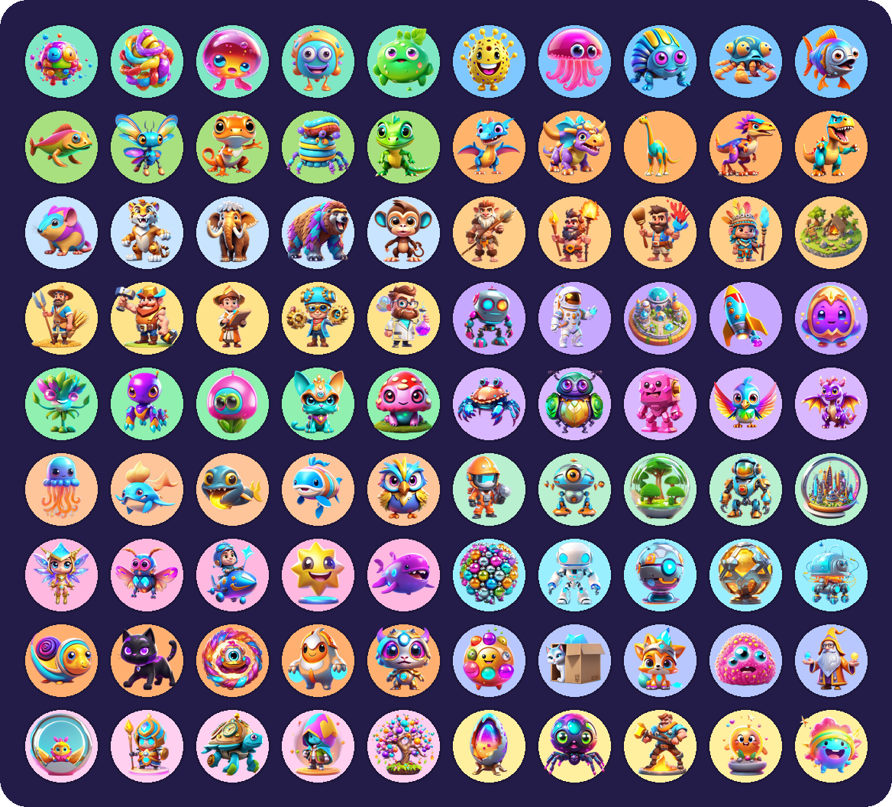
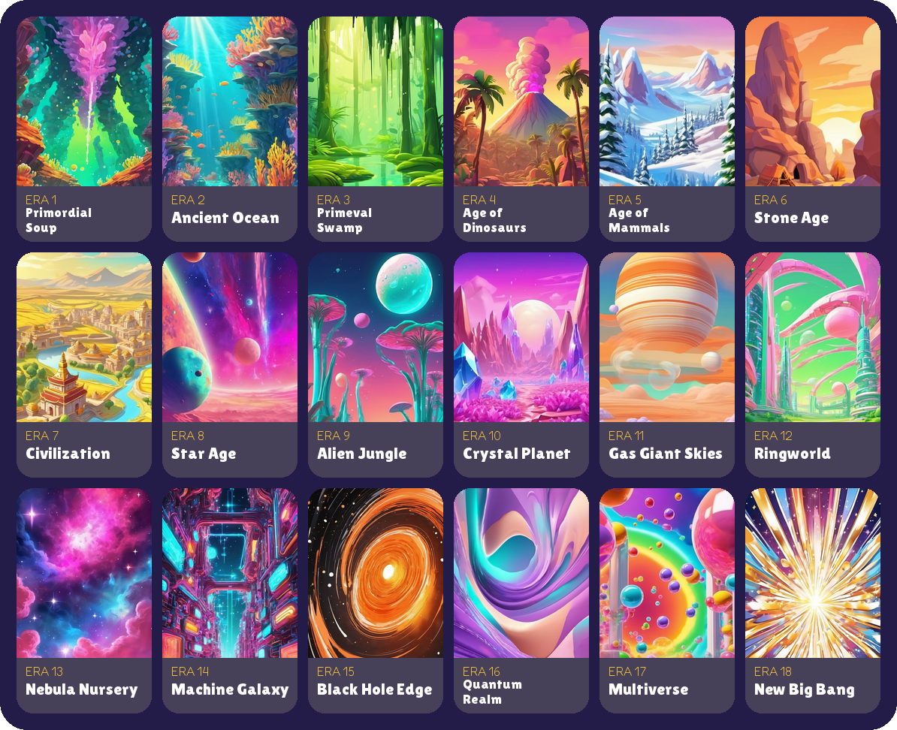

  

<h3 align="center">Tap a single cell into life and evolve it all the way to a new Big Bang.</h3>

  A cozy idle evolution game for Android by <b>BananaWare</b>.

  
  
  
  

  

  <a href="https://primordial-idle.vercel.app">Website</a> ·
  <a href="https://github.com/LuisPCFialho/primordial-apk/releases">All versions</a> ·
  <a href="https://primordial-idle.vercel.app/privacy.html">Privacy policy</a>

---

## 🎬 Trailer

  
   
  ▶ <a href="https://www.youtube.com/watch?v=w99szyoVeSs">Watch it on YouTube with sound</a> · <a href="media/primordial-trailer.mp4">download the MP4</a> · recorded before the cosmic update, so it shows the first 8 eras

## ✨ New in 0.4.0: the cosmic update

The Star Age was only the beginning. **50 new species** now live in **10 new cosmic eras**, from an Alien Jungle
and a Crystal Planet to the edge of a black hole, the Quantum Realm, the Multiverse and, finally, a **New Big Bang**.
Complete the Tree of Life and every unspent Gene starts boosting your production, so the late game keeps moving.

<table>
  <tr>
    <td width="36%" align="center"></td>
    <td>
      <h3>18 eras, one planet</h3>
      Every era has its own world, ambient particles and creatures:
      <ol>
        <li>Primordial Soup</li><li>Ancient Ocean</li><li>Primeval Swamp</li><li>Age of Dinosaurs</li>
        <li>Age of Mammals</li><li>Stone Age</li><li>Civilization</li><li>Star Age</li>
        <li>Alien Jungle</li><li>Crystal Planet</li><li>Gas Giant Skies</li><li>Ringworld</li>
        <li>Nebula Nursery</li><li>Machine Galaxy</li><li>Black Hole Edge</li><li>Quantum Realm</li>
        <li>Multiverse</li><li>New Big Bang</li>
      </ol>
    </td>
  </tr>
</table>

## 📱 Screenshots

  
  
  
  

## 🧬 The game

| | |
|---|---|
| 🦠 **90 species** | From amino acids and jellyfish to the T-Rex, robots, crystal dragons, space whales and Schrödinger's Cat. Level them up and hit milestones that multiply their output. |
| 🌳 **Tree of Life** | 205 traits across six branches: Ocean, Land, Sky, Mind, Symbiosis and Extinction. Unlock game-changing Keystones and plan your own build. |
| ☄️ **Mass Extinction** | Wipe the planet clean to earn Genes. Your Tree of Life survives, so every run goes further. |
| ⚡ **Boosts** | Genetic Frenzy, Golden Meteors, Time Warps, Rare Mutations, instant evolution and Boost Recharge. |
| 💖 **Happy creatures** | Tap a creature 12 times in a row and it pays you back with a DNA bonus. |
| 🎁 **Every day** | Daily gifts that grow with your streak, daily missions and 35 achievements. |
| 🏆 **World rankings** | Compete on Google Play Games for taps, levels bought and extinctions. |
| 💤 **Offline progress** | Life keeps evolving while you are away (the clock comes from the internet, so no date tricks). |
| 🌍 **6 languages** | English, Português (Portugal and Brasil), Español, Français and Deutsch. |

## 🐾 Meet the species

  

## 🌌 The eras

  

## 📥 Install

1. On your Android phone, open **[Primordial.apk (latest)](https://github.com/LuisPCFialho/primordial-apk/releases/latest/download/Primordial.apk)**.
2. If Android asks, allow your browser to **install unknown apps**.
3. Open the downloaded file and tap **Install**.

Requires **Android 7.0** or newer.

## 🔄 Update

The game tells you when a new version is out. Download it from the same link and install it over the old one:
**your progress is kept**. Every version and its notes are in [Releases](https://github.com/LuisPCFialho/primordial-apk/releases).

## ❓ FAQ

<b>I already have Primordial from Google Play. Can I install the APK?</b>

 
Not over it: the Google Play build and this APK are signed with different keys, so Android refuses to install one
over the other. Use one or the other, or uninstall first (you will lose your progress).

<b>Why do the ads say "Test Ad"?</b>

 
This APK uses Google's test ads, which never earn anything. The Google Play version shows real ads.
Ads are always optional: they only give you boosts.

<b>Where is the source code?</b>

 
The source is private. This repository only hosts the test builds (APK), the trailer and the images.

---

   
  © 2026 BananaWare · <a href="https://primordial-idle.vercel.app">primordial-idle.vercel.app</a>

